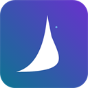

<p align="center">
  
</p>

<h1 align="center">SharkTab</h1>

<p align="center">
  一个克制、暗玻璃风格的 Edge 新标签页。
</p>

<p align="center">
  <code>Edge</code> <code>Manifest V3</code> <code>No build</code>
</p>

SharkTab 把新标签页收拢成以搜索为中心的起始页：顶部是时间与农历，中间是搜索框，下方是可以自由整理的快捷入口。没有资讯流、没有推荐、没有账号体系。

## 功能

- **时间与日期**：Roboto 数字 + 24 小时制、星期、农历，只在分钟变化时更新。
- **多引擎搜索**：Bing / Google / 百度 随时切换，选择会记住；搜索在新标签页打开，原新标签页保留。
- **快捷入口**：8 列网格（窄屏 6 列），支持添加、编辑、删除、长按拖动排序；超过 2 行自动折叠，底部箭头展开 / 收起。
- **图标自动识别**：优先读取浏览器 favicon 缓存，其次站点 `favicon.ico`，再次 `icon.horse`；失败显示首字母色块并缓存 30 分钟，也可以上传自己的图标。
- **自定义壁纸**：上传后按显示上限缩放并压缩为 WebP，再存入 IndexedDB，刷新自动恢复；壁纸之上有 30% 暗色遮罩，界面使用低透明度暗玻璃表面。
- **页面操作**：右下角常驻「···」入口，随时新增快捷入口 / 更换壁纸 / 恢复默认背景；空白处右键仍然可用。
- **右键与快捷键**：磁贴右键可打开、复制链接、编辑、删除；`/` 聚焦搜索框，`Esc` 关闭菜单 / 清空输入。

## 安装（开发版）

当前以本地加载为主，Edge Add-ons 商店上架所需素材见 `store-assets/`。

```bash
git clone https://github.com/Chen1shark/SharkTab.git
```

1. 打开 `edge://extensions/`
2. 打开左下角「开发人员模式」
3. 点击「加载解压缩的扩展」，选择仓库根目录
4. 新建标签页即可看到 SharkTab

修改文件后，在扩展页点「重新加载」，再打开新标签页生效。

## 使用

| 操作 | 行为 |
| --- | --- |
| `Enter` | 用当前引擎搜索，结果在新标签页打开 |
| 点击快捷入口 | 在新标签页打开，不替换当前新标签页 |
| `/` | 聚焦搜索框 |
| `Esc` | 关闭菜单并把焦点还给触发元素；无菜单时清空输入 / 失焦 |
| 菜单内 `↑` `↓` `Home` `End` | 在可见菜单项之间移动焦点 |
| 右侧引擎按钮 | 在 Bing / Google / 百度 间切换 |
| 磁贴右键 | 在新标签页打开 / 复制链接 / 编辑 / 删除 |
| 右下角「···」 | 新增快捷入口 / 更换壁纸 / 恢复默认背景 |
| 空白处右键 | 新增快捷入口 / 更换壁纸 / 恢复默认背景 |
| 长按磁贴约 400ms | 进入拖动排序 |

搜索框只负责搜索，不识别网址；访问网站请使用地址栏或快捷入口。中文输入法选词时按 Enter 不会误触发搜索。

## 隐私

SharkTab 不收集、不上传任何个人数据，没有分析、遥测或广告代码。

- 快捷入口、搜索引擎选择保存在浏览器 `localStorage`
- 自定义壁纸保存在本机 IndexedDB
- 站点图标只在用户本地运行时获取，按域名缓存，不进入扩展包
- 搜索词只在用户主动提交搜索时发送给所选搜索引擎
- 获取图标时可能请求用户所填网址的 `favicon.ico` 或 `icon.horse`

详见 [隐私政策](store-assets/privacy-policy.md) 与 [第三方图标说明](THIRD_PARTY_NOTICES.md)。

## 本地预览

项目不需要构建，直接用浏览器打开 `index.html` 即可。也可以使用任意静态 HTTP 服务。

`file://` 下部分浏览器会限制 IndexedDB，因此自定义壁纸的持久化建议在扩展环境或 HTTP 服务下验证。

## 项目结构

| 文件 | 作用 |
| --- | --- |
| `manifest.json` | Edge MV3 扩展清单，覆盖新标签页；`name` / `description` 走 `__MSG_` 占位符 |
| `_locales/zh_CN/messages.json` | 扩展名称与简短描述的中文本地化，Edge 加载项商店据此识别「简体中文」 |
| `index.html` | 页面结构：时间、搜索框、快捷入口、弹窗 |
| `styles.css` | 暗玻璃视觉、壁纸遮罩、网格与弹窗样式 |
| `app.js` | 搜索引擎、搜索提交、快捷键、快捷入口增删改查与拖动 |
| `clock.js` | 时间、星期与农历格式化 |
| `wallpaper.js` | 壁纸压缩、串行写入、IndexedDB 存取、刷新恢复 |
| `page-menu.js` | 空白处右键与右下角「···」页面菜单 |
| `icons/app/` | 扩展自身图标：16 / 32 / 48 / 128px |
| `icons/engines/` | 搜索引擎标识（Bing / Google / 百度） |
| `fonts/` | 时钟数字使用的 Roboto 字体（SIL OFL 1.1）与许可证 |
| `store-assets/` | 商店 300×300 logo、商店文案、隐私政策 |
| `THIRD_PARTY_NOTICES.md` | 第三方图标来源与商标说明 |

`dist/` 是本地生成的可上传 zip，已在 `.gitignore` 中忽略，不随仓库提交。

## 数据与缓存

| 数据 | 位置 |
| --- | --- |
| 快捷入口 | `localStorage` · `sharktab.shortcuts.v1` |
| 搜索引擎 | `localStorage` · `sharktab.engine` |
| 站点图标缓存 | `localStorage` · `sharktab.icons.v2`（60 天、最多 80 条） |
| 图标失败记录 | `localStorage` · `sharktab.iconFailures.v1`（30 分钟、最多 80 条） |
| 自定义壁纸 | IndexedDB · `sharktab` / `wallpaper`（压缩后的 WebP） |

想恢复默认设置，可在新标签页 DevTools 中执行：

```js
localStorage.removeItem('sharktab.shortcuts.v1');
localStorage.removeItem('sharktab.icons.v2');
localStorage.removeItem('sharktab.iconFailures.v1');
localStorage.removeItem('sharktab.engine');
```

壁纸可在页面右键菜单选择「恢复默认背景」。

## 已知限制

- 站点图标依赖站点自身 favicon 或第三方图标服务；首次加载可能先显示首字母色块，部分站点没有可用图标或只有低分辨率图标。
- 图标由各站点提供，版权与商标归各自所有者；本项目只将其用于导航指引。
- 数据只保存在本机，不提供跨设备同步。
- 目前针对 Edge 新标签页开发，没有移动端版本。

## 第三方图标与商标

本扩展显示的第三方网站图标仅用于导航指引，版权归各自所有者所有。

图标来源、内置资源与商标归属详见 [THIRD_PARTY_NOTICES.md](THIRD_PARTY_NOTICES.md)。
